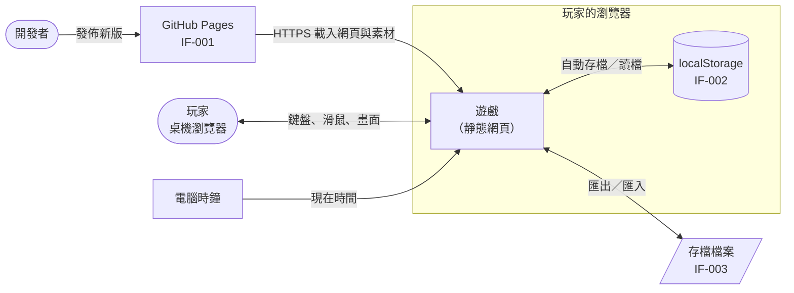
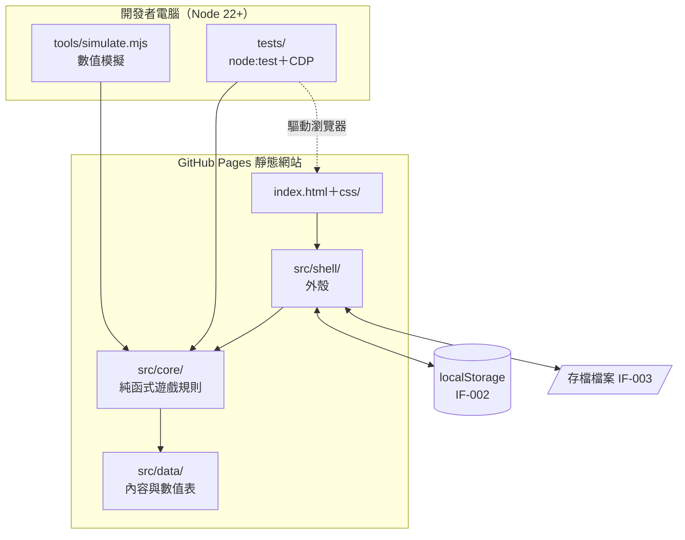
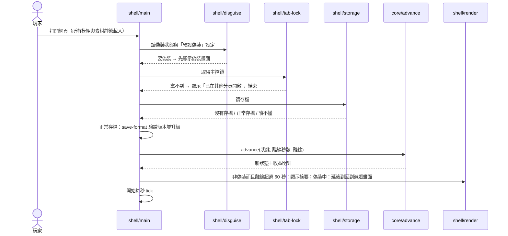
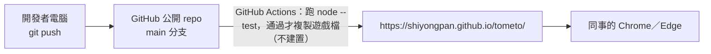

# tometo 架構描述

- 狀態：草稿（已依 spec-reviewer 審查 RV-01～44 修正）
- 最後更新：2026-11-20
- 範圍：第一版（單人，里程碑 v0.1／v1.0）；多人版之後另外補

## 1. 架構目標與驅動因素
品質屬性依 `01` 5.1 的順序排列：

| 順序 | 驅動因素 | 代表的品質情境 |
|---|---|---|
| 1 | 易用性：一鍵隱藏 1 秒內生效、偽裝像試算表、重新整理後維持偽裝、3 分鐘上手、回來 30 秒做完一件事 | QS-001～007 |
| 2 | 可復原性：存檔最多落後 30 秒、壞檔不覆蓋、多分頁不互蓋、匯出提醒 | QS-010～015 |
| 3 | 可維護性：新增內容只改資料表、數值模擬工具 | QS-020、021 |
| 4 | 效能：掛機 CPU 低於 1%、開啟／結算／匯入 2 秒內 | QS-030～033 |
| 5 | 擴展性：遊戲規則能直接在 Node 執行 | QS-040 |
| 6 | 可用性：斷網時已開的分頁照常玩 | QS-050 |
| 7 | 安全：匯入不執行程式、載入後零網路請求、不含公司資訊 | QS-060～062 |

另一個設計原則：在線與離線用同一套「經過時間 → 收益」公式；同一段時間不論切成幾段計算，結果差距在 1% 以內（SYS-007）。

## 2. 限制條件摘要
| 編號 | 限制 | 對架構的影響 |
|---|---|---|
| CON-001 | ES modules、不建置、無外部套件 | 用瀏覽器原生 `import`；`core/` 與 `data/` 同時給 Node 用；型別用 JSDoc＋`// @ts-check` 由 VS Code 檢查（ADR-0003）；只有單檔備案可以串檔 |
| CON-002 | 開發工具只用 Node 22+ 內建模組 | 模擬工具與測試用 `node:test`、`node:assert` |
| CON-003 | `load` 之後零網路請求 | 所有模組靜態 `import`（不用動態 `import()`）；圖示與偽裝素材用 data URL 內嵌；不用 CDN、字型服務、分析工具 |
| CON-004 | GitHub Pages | 純靜態檔案；沒有伺服器端程式 |
| CON-005 | Chrome／Edge 基準版本以上 | 可以直接用 Web Locks、`BroadcastChannel` 等 API |
| CON-006 | repo 公開、不含公司資訊 | 偽裝畫面的假資料用虛構內容；commit 用個人 email |
| CON-007 | 一人業餘開發 | 結構越少越好；不做目前用不到的抽象 |

## 3. 系統情境與範圍
第一版（單人）：

- 網頁載入完成後不發出任何網路請求（CON-003）。
- 範圍外：遊戲主機、玩家之間的連線，多人版才加（STK-003）。

## 4. 解決方案策略
### 4.1 選定的架構：純函式核心＋DOM 外殼
把程式分成三層：

| 層 | 內容 | 規則 |
|---|---|---|
| `src/data/` | 設施、角色、裝備、敵人、區域、成就、任務、數值表（含離線折扣與上限） | 只有資料，沒有邏輯；新增內容與調整數值只改這裡（QS-020） |
| `src/core/` | 遊戲規則：`advance(狀態, 經過秒數, 模式)` 與 `apply(狀態, 動作)`；`模式` 是「在線」或「離線」 | 純函式：輸入相同、輸出就相同；不碰 DOM、localStorage、`Date.now()`、`Math.random()`（QS-040） |
| `src/shell/` | 計時、時鐘、存檔、分頁鎖、匯出入、偽裝、聲音、DOM 畫面、設定 | 所有副作用都在這一層 |

重點：
- **同一套公式**：在線時外殼每次 tick 呼叫 `advance(狀態, 經過秒數, 在線)`；離線呼叫一次 `advance(狀態, 離線秒數, 離線)`。折扣與上限由 `core` 從 `data/` 讀取，外殼與模擬工具不必各自維護一份（SYS-003）。
- **分段計算**：`advance` 先找出這段時間內最早會發生的事件（角色升級、資源足夠解鎖、到達離線上限），算到事件為止，套用事件後再算剩下的時間。結果跟每秒計算一次的差距在 1% 以內（SYS-007）；計算量跟事件數成正比，跟經過時間長短無關（QS-032）。
- **掉落累積期望值**：每種掉落在狀態裡有一個累積值，依期望掉落率增加，累積滿 1 就給 1 件。不用亂數，所以分段方式不影響結果（SYS-007）。
- **在線與離線的界線**：外殼用現在時間減上次 tick 時間當經過秒數。不超過 120 秒就全部算在線；超過時，前 120 秒算在線、其餘算離線（SYS-002、006）。
- **DOM 畫面、只在需要時重畫**：分頁在背景或偽裝時不更新畫面，只做計算（SYS-030）。
- **模擬工具**：`tools/simulate.mjs` 在 Node 直接 import `core/` 與 `data/`，快轉典型玩家，算出第一次轉生在第幾天，目標是第 7～14 天（QS-021）。

### 4.2 考慮過的替代方案
| 方案 | 說明 | 不選的原因 |
|---|---|---|
| B：北境求生做法 | canvas 每幀重畫、classic script、可變的全域狀態 | 每幀重畫違反 QS-030；在線逐幀與離線公式結果不一致（SYS-007）；規則跟畫面綁在一起，模擬工具與多人版都難做（QS-021、040） |
| C：A＋Web Worker | `core` 在 Worker 執行 | 計算量很小，用不到「畫面不被卡住」的好處；多一層訊息傳遞，除錯變麻煩（CON-007） |
| D：可變狀態物件＋DOM | 傳統放置遊戲寫法，全域 `Game` 物件由 `setInterval` 直接修改 | 結果受執行順序影響，SYS-007 難測；Node 模擬要先拆掉 DOM；多人版要重寫核心 |
| E：純函式核心＋UI 框架 | Preact、Lit 等，狀態變了由框架重畫 | 違反 CON-001（外部套件）；只有手寫 DOM 太繁瑣時才值得重新考慮（見 ADR-0001 重新檢視條件） |
| F：遊戲引擎 | Phaser、Godot Web 匯出等 | 每幀渲染違反 QS-030；違反 CON-001；偽裝畫面難做 |

業界常見的放置遊戲（例如 Cookie Clicker、Antimatter Dimensions）也多半是 DOM 加上時間差結算，跟 A 同一路線。

## 5. 建構視圖
### 5.1 容器視圖

| 容器 | 執行環境 | 責任 | 對應需求 |
|---|---|---|---|
| `index.html`＋`css/` | 瀏覽器 | 頁面骨架、遊戲與偽裝兩套樣式；偽裝根元素在 HTML 裡就存在 | SYS-020、023、025 |
| `src/shell/` | 瀏覽器 | 所有副作用（見 5.2） | SYS-002、004～006、010～026、030、040、041 |
| `src/core/` | 瀏覽器與 Node | 遊戲規則 | SYS-001、003、007、012、013、100～160 |
| `src/data/` | 瀏覽器與 Node | 內容與數值 | SYS-101，QS-020 |
| `tools/simulate.mjs` | Node | 數值模擬 | QS-021、SYS-160 |
| `tools/serve.mjs` | Node | 本機開發用的靜態伺服器（ES modules 不能用 `file://` 載入），只用 Node 內建模組 | ADR-0003 |
| `tests/` | Node：`core` 用 `node:test`；外殼用 Chrome DevTools Protocol 驅動無頭 Chrome／Edge，做法複製自北境求生 | 自動化測試 | 各 SYS 的「測試」驗證；QS-001、007、050、061 |

### 5.2 元件視圖
以下是模組切法，實作時可以調整。

**`src/core/`**
| 模組 | 責任 | 對應需求 |
|---|---|---|
| `state.js` | 新遊戲的初始狀態與狀態結構 | SYS-170（空白存檔） |
| `advance.js` | `advance(狀態, 秒數, 模式)`：分段計算設施產出、冒險戰鬥期望值、經驗、掉落累積值；離線時套用 `data/` 的折扣與上限；不自動挑戰 Boss | SYS-001、003、007、100、120、121、131、132 |
| `actions.js` | `apply(狀態, 動作)`：建造、升級、招募、製作、換裝、轉生、領取任務、區域解鎖 | SYS-100、110～112、133、150、160 |
| `combat.js` | Boss 戰的計算（在線手動） | SYS-130 |
| `progress.js` | 成就、目標、短任務的判定 | SYS-140、160 |
| `prestige.js` | 轉生：保留與重置的規則 | SYS-150 |
| `save-format.js` | 存檔的序列化、結構與大小驗證、版本比對與升級 | SYS-012、013、016，QS-060 |
| `rng.js` | 固定種子的亂數；種子存在狀態裡；只給 Boss 戰等少數需要隨機的地方用 | SYS-130（ADR-0006） |

**`src/shell/`**
| 模組 | 責任 | 對應需求 |
|---|---|---|
| `main.js` | 啟動流程（6.1） | SYS-004、017、025 |
| `clock.js` | 讀現在時間；時間倒退時經過秒數算 0，「上次時間」取兩者中較晚的值 | SYS-005 |
| `loop.js` | 每秒 tick：算經過秒數、分出在線與離線兩段、呼叫 `advance`、標記畫面要重畫 | SYS-001、002、006、030 |
| `storage.js` | 存檔：距上次滿 30 秒的第一次 tick、`visibilitychange`、`pagehide` 時存；先寫暫存鍵再換正式鍵，保留上一份成功的存檔；寫入失敗時警告並重試；鍵名加遊戲前綴 | SYS-010、016～018，QS-010、014 |
| `tab-lock.js` | 用 Web Locks 取得主控權；拿不到鎖的分頁不計算、不存檔，顯示「已在其他分頁開啟」 | SYS-019，QS-015 |
| `export-import.js` | 下載存檔檔案；選擇檔案、驗證、顯示摘要並確認、先備份再取代；3 天提醒 | SYS-011、012、014、015，QS-011～013 |
| `disguise.js` | 隱藏鍵：切換偽裝畫面、分頁標題與圖示（data URL）；記住偽裝狀態；按鍵監聽不受降頻影響 | SYS-020、021、025，QS-001、007 |
| `sound.js` | 預設靜音；偽裝或背景時不播放 | SYS-022、024 |
| `render/` | 各面板（設施、角色、裝備、冒險與戰鬥紀錄、Boss、成就、任務、設定），只在可見而且有變動時更新；文字一律用 `textContent` | SYS-004、023、030、122，QS-005、060 |
| `tutorial.js` | 新手引導 | SYS-170，QS-004 |
| `settings.js` | 隱藏鍵（含驗證）、音量、動畫開關、開啟時預設偽裝 | SYS-026、040、041，QS-003 |

## 6. 執行期視圖
### 6.1 打開遊戲與離線結算

- 沒有存檔：建立新遊戲並啟動新手引導（SYS-170）。
- 讀不懂（正式與備份都壞掉、版本升級失敗）：走 6.6，不開新遊戲（SYS-017）。
- 存檔版本比程式新：拒絕讀寫，提示重新整理（SYS-016）。
- 載入（有快取）2 秒內、離線結算 2 秒內（QS-031、032）。

### 6.2 在線掛機與切到背景
1. `loop` 每秒 tick：經過秒數＝現在時間－上次 tick 時間（倒退時為 0）。
2. 經過秒數不超過 120 秒：`advance(狀態, 秒數, 在線)`；超過：先算 120 秒在線，再算其餘的離線（SYS-002、006）。電腦睡眠一晚醒來，就屬於後者。
3. 分頁可見而且沒有偽裝時才更新畫面；在背景或偽裝時只計算（SYS-030）。
4. 距上次存檔滿 30 秒的第一次 tick 存檔；分頁隱藏或關閉時也存（SYS-010）。背景時計時器可能 1 分鐘才觸發一次，所以存檔最多落後 1 次 tick 間隔＋30 秒（QS-010）。

### 6.3 按下隱藏鍵
1. `disguise` 在 `window` 上監聽隱藏鍵，收到就直接切換：遊戲根元素隱藏、偽裝根元素顯示、換分頁標題與圖示（data URL，不發請求）（QS-001、061）。
2. 立刻把偽裝狀態寫進 localStorage（SYS-025）；`sound` 停止播放（SYS-024）。
3. 計時與存檔照常進行；畫面停止更新。
4. 再按一次就切回遊戲，立刻重畫；有延後的離線摘要就在這時顯示（SYS-021、025）。

### 6.4 失敗情境：匯入損壞或惡意的檔案
1. 玩家選擇檔案 → 先檢查檔案大小，超過上限直接拒絕（QS-060）。
2. 用 `JSON.parse` 讀取，不用 `eval`，不把內容當 HTML 插入；只接受白名單欄位，忽略 `__proto__`、`constructor` 這類鍵（QS-060）。
3. `save-format` 檢查結構、版本與數值範圍；不通過就拒絕並顯示原因，現有狀態與 localStorage 都不變（SYS-012，QS-013）。
4. 通過驗證：顯示檔案的存檔時間與進度摘要，請玩家確認（SYS-014）。
5. 確認後：把目前的存檔另存成「匯入前備份」，再取代狀態、立刻存檔。不依檔案時間做離線結算，避免「匯出、繼續玩、再匯入舊檔」重複領收益（SYS-015）。

### 6.5 失敗情境：瀏覽器當掉或電腦突然關機
1. 最後一次成功存檔最多落後 30 秒（前景）（QS-010）。
2. 重新打開時走 6.1；上次 tick 到現在的間隔一定超過 120 秒，所以中斷期間除了前 120 秒，都以離線計算（SYS-006）。系統分不出「當掉」與「玩家關掉」，兩者一樣處理。
3. 寫到一半當掉：`storage` 先寫暫存鍵、成功後才換正式鍵，並保留上一份成功的存檔當備份鍵；讀檔時正式鍵壞了就用備份鍵。

### 6.6 失敗情境：存檔讀不懂或寫入失敗
1. 啟動時正式鍵與備份鍵都讀不懂，或版本升級丟出例外：不覆蓋任何 localStorage 資料，顯示提示，提供「匯出原始資料」（把原始字串下載成檔案）與「從匯出檔還原」（走 6.4）；不自動開新遊戲（SYS-017，QS-014）。
2. 寫入失敗（`QuotaExceededError`、儲存被停用、無痕模式限制）：在畫面角落顯示不顯眼的警告，下一次存檔時機繼續重試；遊戲照常進行（SYS-018）。

### 6.7 失敗情境：同時開了兩個遊戲分頁
1. 第一個分頁用 Web Locks 取得主控鎖，持有到分頁關閉為止（SYS-019）。
2. 第二個分頁拿不到鎖：不讀檔、不計算、不存檔，只顯示「已在其他分頁開啟」，並在背景等待鎖。
3. 第一個分頁關閉後，第二個分頁拿到鎖，從 6.1 讀檔開始（QS-015）。
4. 新版發佈後還開著的舊版分頁：讀到比自己新的存檔版本就停止寫入（SYS-016）。

## 7. 部署視圖

- 發佈：push 到 `main` 時，GitHub Actions 先跑 `node --test`，通過才組裝：把 `css/`、`src/`、素材複製到 `v/<commit 短雜湊>/`，改寫 `index.html` 的路徑後發佈；只複製與字串替換、不建置（CON-001、IF-001）。
- `tools/`、`tests/`、`docs/` 不出現在網站上，但 repo 公開，所以裡面一樣不能有公司資訊；commit 作者用個人 email，不用公司 email（CON-006）。
- 版本一致：模組放在 `v/<commit 短雜湊>/`，由 Actions 自動產生；repo 裡的原始碼仍在 `src/`。避免 Pages 快取造成「部分舊模組＋部分新模組」（R9）。
- 新版發佈後，玩家重新整理才會拿到新版；舊存檔由 `save-format` 自動升級（SYS-013）。
- 單檔備案（ASM-002）：`tools/bundle.mjs` 用 Node 內建模組把模組串成一個 HTML 檔，只在公司擋掉 github.io 時使用。

## 8. 橫切關注點
| 主題 | 做法 |
|---|---|
| 時間 | 存檔與匯出檔裡的時間一律 UTC 毫秒整數；只有 `shell/clock` 讀時鐘；`core` 只收「經過秒數」與模式。時間倒退時算 0，「上次時間」取較晚的值（SYS-005） |
| 在線與離線 | tick 間隔 120 秒為界（SYS-002、006）；折扣與上限在 `data/` |
| 隨機性 | 自動戰鬥與掉落用期望值與累積值，不用亂數（SYS-007）；Boss 戰需要隨機時用 `core/rng` 的種子亂數，種子存在狀態裡（ADR-0006） |
| 戰鬥紀錄 | 只是畫面表現，由 `render` 根據 `advance` 的結果產生，不寫進狀態（SYS-122） |
| 存檔版本 | 存檔帶 `saveVersion`（IF-002、003）；`save-format` 依序套用升級函式，從 v0.1 起的存檔都能升到最新（SYS-013）；版本比程式新就拒絕（SYS-016） |
| 儲存鍵 | 一律加前綴 `ws1:`（跟遊戲名無關），避免跟同一 GitHub 帳號底下其他 Pages 衝突；鍵名配置見 IF-002 |
| 大數字 | 先用 JavaScript 的 `Number`（上限約 1.8×10³⁰⁸），顯示用科學記號或單位縮寫；模擬工具檢查轉生前的最大數值（R3） |
| 載入 | 所有模組靜態 `import`、素材在啟動時載入，圖示與偽裝素材用 data URL；`load` 之後零網路請求（CON-003） |
| 畫面輸出 | 一律用 `textContent` 或建立元素，不用 `innerHTML` 插入存檔來的文字（QS-060） |
| 聲音 | 預設靜音；只在分頁可見而且沒有偽裝時播放（SYS-022、024） |
| 型別 | 每個檔案開頭 `// @ts-check`，型別寫在 JSDoc，由 VS Code 內建的 TypeScript 檢查；CI 不檢查型別（ADR-0003） |
| 語言 | 只有繁體中文 |
| 測試 | `core` 用 `node:test`（含 SYS-007 的分段一致性測試，以及檢查 `src/core/` 沒有出現 `Date.now`、`Math.random` 的測試，ADR-0006）；外殼（隱藏 1 秒內、偽裝保存、存檔、多分頁、斷網、零網路請求、匯入）用 CDP 驅動無頭 Chrome／Edge |

## 9. 架構決策摘要
| ADR | 決策 | 狀態 |
|---|---|---|
| [ADR-0001](adr/0001-pure-core-dom-shell.md) | 純函式核心＋原生 DOM 外殼 | 已接受 |
| [ADR-0002](adr/0002-elapsed-time-formula.md) | 在線與離線用同一套「經過時間 → 收益」公式，分段計算 | 已接受 |
| [ADR-0003](adr/0003-es-modules-no-build.md) | ES modules＋JSDoc 型別檢查，不建置、無外部套件 | 已接受 |
| [ADR-0004](adr/0004-github-pages.md) | 發佈在 GitHub Pages，repo 公開 | 已接受 |
| [ADR-0005](adr/0005-browser-only-saves.md) | 第一版存檔只放 localStorage＋匯出檔 | 已接受 |
| [ADR-0006](adr/0006-seeded-rng-injected-time.md) | core 不讀時鐘、不用 `Math.random`；時間由外殼傳入，種子存在狀態裡 | 已接受 |
| [ADR-0007](adr/0007-static-disguise.md) | 偽裝畫面用靜態樣板試算表 | 已接受 |

## 10. 品質情境對應
| QS | 由哪個架構元素滿足 |
|---|---|
| QS-001 | `disguise` 在 `window` 監聽按鍵、直接切換兩個根元素（6.3） |
| QS-002、003 | 偽裝畫面是靜態樣板＋灰白樣式；遊戲本體用低飽和色，動畫可以關（`settings`） |
| QS-004 | `tutorial` |
| QS-005 | 離線收益自動入帳，摘要直接顯示；主畫面把可升級的項目放在第一屏 |
| QS-006 | 只有 `disguise` 註冊全域按鍵 |
| QS-007 | `main` 啟動第一步讀偽裝狀態；偽裝根元素在 HTML 裡就存在、預設依狀態顯示 |
| QS-010 | `storage` 依 30 秒規則存＋`visibilitychange`、`pagehide` 時存；暫存鍵與備份鍵 |
| QS-011～013 | `export-import`＋`save-format` 驗證（6.4） |
| QS-014 | 6.6：不覆蓋原始資料、警告與重試 |
| QS-015 | `tab-lock`（6.7） |
| QS-020 | 內容、數值、折扣與上限全在 `data/` |
| QS-021 | `tools/simulate.mjs` 直接使用 `core/`＋`data/` |
| QS-030 | 背景與偽裝時不重畫；每秒一次 tick 只做公式計算 |
| QS-031 | 沒有建置也沒有外部資源，檔案少而小 |
| QS-032 | `advance` 分段計算，計算量跟事件數成正比 |
| QS-033 | 存檔是一份小 JSON |
| QS-040 | `core` 是純函式，不碰 DOM、儲存與時鐘 |
| QS-050 | `load` 之後不需要網路（CON-003） |
| QS-060 | 大小上限＋`JSON.parse`＋白名單欄位＋`textContent` |
| QS-061 | 靜態 `import`、data URL 圖示；CDP 測試監看請求 |
| QS-062 | 發佈前檢查清單；commit 用個人 email（CON-006） |

## 11. 風險與技術債
| # | 風險 | 影響 | 對策 |
|---|---|---|---|
| R1 | 玩家清除網站資料或換電腦，localStorage 存檔不見 | 進度遺失（STK-004） | 匯出檔＋3 天提醒（QS-012）；多人版存到主機 |
| R2 | 自動戰鬥用期望值公式計算，可能顯得單調 | 好玩程度 | 在線時用戰鬥紀錄呈現過程（SYS-122）；Boss 戰另外用 `combat.js` 做出變化 |
| R3 | 數字超過 `Number` 上限或精度不足 | 後期數值錯誤 | 模擬工具檢查轉生前的最大數值；超過時改用對數或另寫大數字模組 |
| R4 | Chrome 對長時間背景的分頁可能凍結或移除 | 那段時間算離線（拿折扣） | 使用者已接受；120 秒界線讓降頻仍算在線（ASM-005） |
| R5 | 偽裝畫面不夠像；網址列、歷史紀錄、自動完成仍會出現 `shiyongpan.github.io/tometo` | M4 失敗 | 用實際試算表的配色與版面；分頁標題與圖示一起換 |
| R6 | 能力很多（14 項 Must），一人業餘開發 | 遲遲做不完 | 兩個里程碑；v0.1 先開始自己玩 |
| R7 | 從 classic script 改成 ES modules、純函式寫法，有學習成本 | 初期進度慢 | 先寫好 `core` 的測試當作範本 |
| R8 | GitHub Pages 網址公開，有人轉傳 | 不在目標範圍內的人來玩 | 可以接受（「不宣傳但可公開」）；遊戲不收集任何資料 |
| R9 | 不建置就沒有檔名雜湊，Pages 快取可能讓玩家拿到新舊混合的模組 | 啟動失敗或存檔錯亂 | 模組放在 `v/<commit 短雜湊>/`；舊目錄是否被下次部署刪除待 IF1-2 查證；SYS-016 擋住新舊版互蓋 |
| R10 | 同一 GitHub 帳號的所有 Pages 共用 localStorage 來源與約 5 MB 容量 | 鍵名衝突、容量不足 | 鍵名前綴（IF-002）；寫入失敗時警告（SYS-018） |
| R11 | 公司瀏覽器可能在關閉時清除網站資料（ASM-003） | 每天進度不見 | 使用者已確認關閉不會清除（2026-11-20）；之後若公司原則改變，重新檢視 ADR-0005 |
| R12 | 分段計算要找出「最早會發生的事件」，事件種類變多時容易漏算 | 在線與離線結果不一致 | SYS-007 的分段一致性測試（隨機切法比對） |

## 12. 名詞
| 名詞 | 定義 |
|---|---|
| 核心（core） | `src/core/`，純函式的遊戲規則 |
| 外殼（shell） | `src/shell/`，負責所有副作用：時間、儲存、畫面、按鍵 |
| tick、在線、離線、偽裝畫面、主控分頁 | 見 `01` 1.4 |
| 分段計算 | `advance` 依事件把一段時間切開，逐段計算 |
| 掉落累積值 | 每種掉落依期望掉落率累積，滿 1 給 1 件 |
