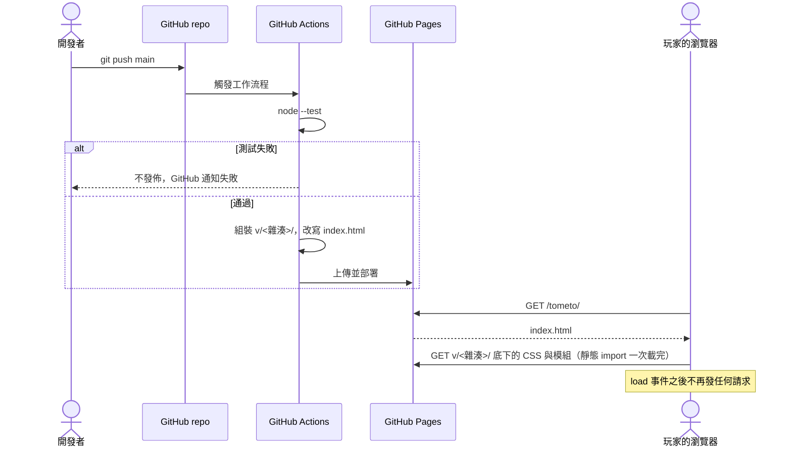

# IF-001：GitHub Pages 發佈與載入

- 狀態：草稿
- 最後更新：2026-11-20
- 對應需求：CON-001、003～006；QS-031、050、061、062；ASM-002；ADR-0003、0004；`02` 第 7 章、R5、R8、R9
- 雙方：本系統（repo、GitHub Actions 工作流程、`index.html`）↔ GitHub Pages（擁有者：GitHub）；使用方是玩家的 Chrome／Edge

內容來源標記：**【我方】** 本系統決定（使用者已確認）；**【假設】** Claude 提議、尚未確認；**【平台】** GitHub 或瀏覽器的行為，要查證的列在第 7 章。

## 1. 概述
兩個方向：
- **發佈**：開發者 push 到 `main` → GitHub Actions 跑測試 → 只把遊戲檔案發佈到 GitHub Pages（ADR-0004）。
- **載入**：玩家用瀏覽器打開網址，載入網頁、程式與素材；`load` 事件之後不再發任何請求（CON-003）。

## 2. 協定與傳輸
| 項目 | 內容 |
|---|---|
| 網址 | `https://shiyongpan.github.io/tometo/`；repo `https://github.com/shiyongpan/tometo`（公開）；不綁自訂網域 【我方】 |
| 協定 | HTTPS，靜態檔案 GET 【平台】 |
| 發佈來源 | Pages 設定的來源選「GitHub Actions」【我方】 |
| 發佈內容 | 只有 `index.html`、`css/`、`src/`、素材；`docs/`、`tests/`、`tools/` 不發佈 【我方】 |
| 版本目錄 | Actions 把 `css/`、`src/` 複製到 `v/<commit 短雜湊>/` 底下，並把 `index.html` 裡的路徑改成指向該目錄 【我方】；repo 裡的原始碼仍在 `src/` |
| 編碼 | 所有文字檔 UTF-8；`index.html` 宣告 `<meta charset="utf-8">` 【我方】 |
| 認證與授權 | 玩家端：無，任何人都能開（R8）【平台】；發佈端：Actions 用 GitHub 自動提供的權杖（`pages: write`、`id-token: write`），不需要個人存取權杖 【平台】`<待確認：查證官方 Pages 部署 action 需要的權限>` |
| 外部網域 | 不載入任何其他網域的資源（CON-003、QS-061）【我方】 |

**關於版本目錄與 CON-001**：發佈時改寫 `index.html` 的路徑是字串替換，不是編譯或打包；遊戲在 repo 裡仍然不經建置就能執行（用 `tools/serve.mjs`）。使用者已確認這不算建置，符合 CON-001（2026-11-20）。

## 3. 訊息／資料定義
### 3.1 發佈的檔案【我方】
| 路徑 | 內容 | 快取 |
|---|---|---|
| `/tometo/index.html` | 入口；引用 `v/<雜湊>/` 底下的 CSS 與模組；偽裝根元素與 data URL 圖示寫在這裡（ADR-0007） | 每次發佈都會變；Pages 的快取標頭 `<待確認：查證>` |
| `/tometo/v/<雜湊>/css/*` | 樣式 | 路徑每版不同，舊路徑不會被新內容覆蓋 |
| `/tometo/v/<雜湊>/src/**/*.js` | ES modules（ADR-0003），全部靜態 `import` | 同上 |
| `/tometo/v/<雜湊>/assets/*` | 素材（若有）；偽裝用的素材改用 data URL | 同上 |

### 3.2 GitHub Actions 工作流程【我方】
| 步驟 | 內容 |
|---|---|
| 觸發 | push 到 `main` |
| 測試 | `node --test`（Node 22 以上，CON-002）；失敗就停止，不發佈 |
| 組裝 | 建立暫存目錄，複製 `index.html`，把 `css/`、`src/`、素材複製到 `v/<commit 短雜湊>/`，替換 `index.html` 裡的路徑 |
| 發佈 | 用 GitHub 官方的 Pages 上傳與部署 action `<待確認：查證目前的官方 action 名稱與版本>` |

## 4. 互動流程

## 5. 錯誤處理與失效行為
| 情況 | 處理 | 對應 |
|---|---|---|
| 測試失敗 | 不發佈，網站維持上一版 | `02` 第 7 章 |
| Pages 部署失敗 | 網站維持上一版；開發者看 Actions 紀錄重試 | — |
| GitHub Pages 掛掉 | 已開的分頁照常玩、偽裝、存檔；新分頁打不開，可以接受 | QS-050 |
| 公司網路擋掉 github.io | 改用單一 HTML 檔發佈（`tools/bundle.mjs`，ADR-0003、0004） | ASM-002 |
| 玩家拿到舊的 `index.html`（快取） | 舊 `index.html` 只會引用舊的 `v/<雜湊>/`，不會混用新舊模組；舊版分頁讀到較新的存檔就停止寫入 | R9、SYS-016 |
| 舊版本目錄被下一次部署刪除 | 開著舊版分頁的玩家重新整理時，舊 `index.html` 若仍在快取裡，會找不到舊模組 `<待確認：Pages 每次部署是否整個取代網站內容；若是，要不要保留最近幾版的目錄>` | R9 |

**冪等性**：同一個 commit 重跑工作流程，產生同樣的 `v/<雜湊>/` 與內容。

**逾時**：Actions 的逾時由 GitHub 管理；部署是否成功以 Actions 頁面為準。

## 6. 非功能
| 項目 | 內容 |
|---|---|
| 頻率 | 發佈：不固定，有改就 push；載入：玩家開啟時一次 |
| 資料量 | 網站大小 `<待確認：v0.1 完成後量測>`；GitHub Pages 的網站大小與流量限制 `<待確認：查證 GitHub 文件>` |
| 載入時間 | 有快取 2 秒內（QS-031）；第一次載入 `<待確認：Q17>` |
| 可用性 | GitHub Pages 免費方案沒有我方可要求的 SLA `<待確認：查證>`；已開的分頁不受影響（QS-050） |
| 測試環境 | 本機用 `tools/serve.mjs` 模擬（也要測版本目錄改寫後的結構）；沒有另外的線上測試環境 【假設】 |
| 密鑰輪替 | 不使用個人存取權杖，沒有要輪替的密鑰 |

## 7. 待確認問題（給對方窗口）
這條介面的「對方」是 GitHub 平台（查公開文件）與公司 IT。

| # | 問題 | 對象 | 為什麼要知道 |
|---|---|---|---|
| IF1-1 | Pages 回應的 `Cache-Control` 標頭，`index.html` 會被快取多久 | 查證 GitHub 文件或實測 | 新版多久後玩家拿得到；R9 |
| IF1-2 | 用 Actions 部署時，是否每次整個取代網站內容（舊的 `v/<雜湊>/` 會不會消失） | 查證 GitHub 文件 | 5 章最後一列 |
| IF1-3 | 官方 Pages 部署 action 的名稱、版本與需要的權限 | 查證 GitHub 文件 | 3.2 |
| IF1-4 | Pages 的網站大小、流量、每小時部署次數限制 | 查證 GitHub 文件 | 6 章 |
| IF1-5 | ~~免費方案是否必須公開 repo~~ 不影響：使用者本來就要公開（2026-11-20） | — | — |
| IF1-6 | ~~版本目錄改寫是否算建置~~ 已確認：不算（2026-11-20） | — | — |
| IF1-7 | ~~repo 名稱與網址~~ 已提供：`shiyongpan/tometo`（2026-11-20） | — | — |

## 8. 對方問題清單（可直接貼給公司 IT）
**連線**
1. 公司網路有沒有封鎖或計畫封鎖 `*.github.io`？
   - 為什麼要知道：我把一個靜態網頁放在 GitHub Pages，上班時要能開。
   - 已在公司電腦試過能開，這題只是確認政策上沒有限制。
2. 有沒有封鎖 `github.com`（推送程式碼用，只在我自己的電腦上用）？
   - 為什麼要知道：如果被擋，我只能在家發佈新版。

## 9. 申請項目
| 項目 | 說明 |
|---|---|
| GitHub 帳號 | 個人帳號 `shiyongpan`；commit 作者在 repo 的 `.git/config` 設為 `shiyongpan` ／ 使用者的個人 Gmail（使用者指定，2026-11-20） |
| repo 設定 | 公開 repo `shiyongpan/tometo` 已建立；還要在 Settings → Pages → Source 選「GitHub Actions」 |
| 防火牆 | 不需要另外申請；公司能開 github.io 已確認（ASM-002） |
