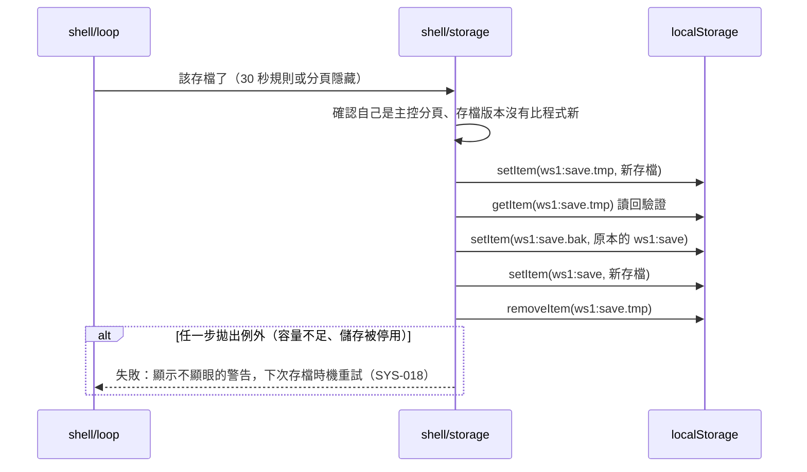

# IF-002：瀏覽器 localStorage

- 狀態：草稿
- 最後更新：2026-11-20
- 對應需求：SYS-010、013、016～019、025、026；QS-010、014、015；ASM-003、005；ADR-0005；`02` R10、R11
- 雙方：本系統 `shell/storage`、`shell/disguise`、`shell/settings`、`shell/tab-lock` ↔ 玩家的 Chrome／Edge（擁有者：瀏覽器廠商；行為可能被公司 IT 原則改變）

內容來源標記：**【我方】** 本系統決定（使用者已確認）；**【假設】** Claude 提議、尚未確認；**【平台】** 瀏覽器行為，要查證的列在第 7 章。

## 1. 概述
遊戲的自動存檔、存檔備份、偽裝狀態與設定都放在這裡（ADR-0005）。資料只存在這台電腦的這個瀏覽器；清除網站資料就不見，要靠 IF-003 匯出檔還原。

## 2. 協定與傳輸
| 項目 | 內容 |
|---|---|
| API | Web Storage API（`localStorage`），同步讀寫，值只能是字串 【平台】 |
| 來源（origin） | `https://<帳號>.github.io`；同一 GitHub 帳號底下所有 Pages 共用同一個來源與容量 【平台】 |
| 容量 | 每個來源約 5 MB 【平台】`<待確認：查證 Chrome／Edge 的確切上限與計算方式（字元或位元組）>` |
| 鍵名前綴 | 一律 `ws1:`，跟遊戲名無關；`1` 是鍵名配置的版本，鍵名配置改變時才改成 `ws2:` 並搬資料 【我方】 |
| 編碼 | 值是 `JSON.stringify` 的結果；時間一律 UTC 毫秒整數 【我方】 |
| 多分頁 | 不靠 localStorage 協調；主控權用 Web Locks API（鎖名 `ws1:main`）【我方】（鎖名【假設】）`<待確認：查證 Web Locks 在 CON-005 基準版本可用>` |
| 認證與授權 | 無；同來源的任何網頁都讀得到（同帳號的其他 Pages 也讀得到）【平台】 |

## 3. 訊息／資料定義
鍵名配置是我方決定；表內的鍵名是 【假設】，實作時可以調整，但 v0.1 發佈後就固定。

| 鍵 | 內容 | 寫入時機 | 說明 |
|---|---|---|---|
| `ws1:save` | 正式存檔：`{ saveVersion, meta, game }` | 每次存檔，寫完暫存鍵後才換 | `saveVersion`、`meta`、`game` 跟 IF-003 3.2 同一套定義 |
| `ws1:save.tmp` | 寫入中的暫存 | 每次存檔第一步 | 寫成功、讀回驗證後，才把原本的 `ws1:save` 搬到 `.bak`、再把暫存換成正式鍵 【假設】（換鍵順序） |
| `ws1:save.bak` | 上一份成功的存檔 | 每次成功換鍵時 | 正式鍵讀不懂時用它（6.5） |
| `ws1:save.preimport` | 匯入前備份 | 確認匯入時 | 只保留最新 1 份（SYS-014） |
| `ws1:settings` | 設定：隱藏鍵、音量、動畫開關、開啟時預設偽裝 | 設定變更時 | 跟存檔分開，啟動時不用解析存檔就能先決定要不要偽裝 【假設】；匯出時合併進 IF-003 的 `payload.settings` |
| `ws1:disguise` | 偽裝狀態：`true`／`false` | 每次切換隱藏鍵時立刻寫入 | 不包含在匯出檔（SYS-025） |

**存檔時機**【我方】：距上次存檔滿 30 秒的第一次 tick、`visibilitychange`（變成 hidden）、`pagehide`（SYS-010）。

**讀檔順序**【假設】：`ws1:save` → 讀不懂就 `ws1:save.bak` → 都讀不懂就走 SYS-017（不覆蓋任何鍵、提示玩家、提供匯出原始資料）。

## 4. 互動流程

## 5. 錯誤處理與失效行為
| 情況 | 處理 | 對應 |
|---|---|---|
| `setItem` 拋出 `QuotaExceededError` | 不刪除任何現有鍵；警告並在下次存檔時機重試 | SYS-018、R10 |
| `localStorage` 被停用或存取時拋出例外（公司原則、無痕模式限制） | 遊戲照常進行，但每次存檔都警告；提示玩家用 IF-003 匯出 | SYS-018、ASM-003 |
| 正式鍵讀不懂 | 改讀 `.bak`；也讀不懂就走 SYS-017 | SYS-017、QS-014 |
| 存檔的 `saveVersion` 比程式新 | 拒絕讀寫，提示重新整理 | SYS-016 |
| 瀏覽器關閉時被清除網站資料 | 偵測不到；下次開啟時看起來像「沒有存檔」→ 新遊戲。不另外提示（使用者決定，2026-11-20；公司瀏覽器已確認不會清除） | ASM-003、R11 |
| 同帳號其他 Pages 寫了 `ws1:` 開頭的鍵 | 不會發生，除非該網站刻意使用同樣前綴；其他 Pages 不要用 `ws1:` | R10 |

**冪等性**：同一份狀態存兩次，結果相同。

**逾時**：同步 API，沒有逾時；寫入大值時會短暫卡住主執行緒，存檔預期很小，可接受。

## 6. 非功能
| 項目 | 內容 |
|---|---|
| 頻率 | 前景約每 30 秒一次；背景時跟著 tick，最慢約每分鐘一次（ASM-005） |
| 資料量 | 每份存檔 `<待確認：v0.1 完成後量測>`；最多同時 3 份（正式、備份、匯入前備份）＋暫存，必須在容量內，所以匯入上限訂為 1 MB（IF-003） |
| 保存期限 | 直到玩家或公司原則清除網站資料 |
| 版本相容 | 同 IF-003：v0.1 起的存檔都能升級（SYS-013） |
| 測試 | CDP 測試：模擬 `setItem` 拋出例外、塞入壞掉的正式鍵、兩個分頁同時開啟、版本比程式新的存檔 |

## 7. 待確認問題（給對方窗口）
| # | 問題 | 對象 | 為什麼要知道 |
|---|---|---|---|
| IF2-1 | Chrome／Edge 每個來源的 localStorage 確切上限與計算方式 | 查證瀏覽器文件 | 決定 1 MB 匯入上限與 3 份備份是否安全 |
| IF2-2 | Web Locks API 在 CON-005 基準版本是否可用 | 查證瀏覽器文件 | 多分頁主控（SYS-019） |
| IF2-3 | 背景分頁計時器最慢多久觸發一次（Chrome 的 intensive throttling） | 查證瀏覽器文件 | ASM-005、120 秒在線界線 |
| IF2-4 | ~~公司 Chrome／Edge 關閉時會不會清除網站資料~~ 已確認：不會（2026-11-20）；版本是否被鎖仍待確認 | 公司 IT | ASM-003、004 |
| IF2-5 | ~~被清除後要不要提示~~ 已決定：不做（2026-11-20） | — | — |

## 8. 對方問題清單（可直接貼給公司 IT）
**資料保存**
1. 公司的 Chrome／Edge 有沒有設定「關閉瀏覽器時清除 Cookie 與網站資料」（例如 ClearBrowsingDataOnExitList、DefaultCookiesSetting 等原則）？
   - 為什麼要知道：我在做的小工具會把資料存在瀏覽器的 localStorage，被清掉的話，每天的資料都會不見。
   - 我們偏好：不清除。
2. 有沒有停用網站的 localStorage，或只限特定網站可以使用？
   - 為什麼要知道：同上。
   - 我們偏好：允許 `*.github.io`。
3. 公司的 Chrome／Edge 會自動更新到最新版，還是鎖在某個版本？
   - 為什麼要知道：會用到較新的瀏覽器功能（例如 Web Locks）。
   - 我們偏好：自動更新。
