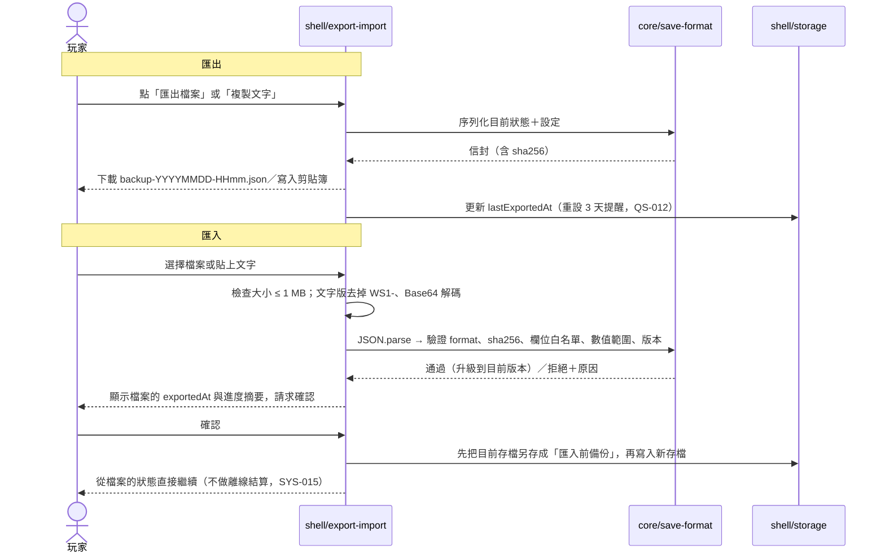

# IF-003：存檔匯出與匯入

- 狀態：草稿
- 最後更新：2026-11-20
- 對應需求：SYS-011～016；QS-011～013、033、060；ADR-0005
- 雙方：本系統 `shell/export-import`＋`core/save-format` ↔ 玩家保管的檔案或文字（擁有者：玩家）

內容來源標記：**【我方】** 本系統決定（使用者已確認）；**【假設】** Claude 提議、尚未確認；**【平台】** 瀏覽器行為，要查證的列在第 7 章。

## 1. 概述
玩家手動備份進度，或換電腦、換瀏覽器時搬存檔。清除網站資料後，這是唯一能救回進度的方式（QS-011）。格式完全由本系統決定，沒有外部擁有者；「對方」是瀏覽器提供的下載、剪貼簿、選擇檔案功能。

## 2. 協定與傳輸
| 項目 | 內容 |
|---|---|
| 形式 | 兩種都提供：**檔案**（下載與選擇本機檔案）與**文字**（複製到剪貼簿、貼上到輸入框）【我方】 |
| 檔名 | `backup-YYYYMMDD-HHmm.json`，時間用玩家電腦的本地時區；不含遊戲名，下載紀錄裡不顯眼 【我方】 |
| 檔案編碼 | UTF-8 JSON，不加 BOM；匯入時遇到 BOM 要略過 【我方】（BOM 處理【假設】） |
| 文字編碼 | 把整份檔案內容（UTF-8 位元組）做 Base64，前面加識別字 `WS1-` 【我方】（識別字【假設】）；貼上時忽略前後空白與換行 |
| 大小上限 | 1 MB；檔案大小或貼上文字解碼後超過就直接拒絕，不解析 【我方】 |
| 認證與授權 | 無；任何人拿到檔案都能匯入（單人版，作弊只影響自己） |
| 下載方式 | 用 `Blob`＋`<a download>` 產生下載，不發網路請求（CON-003）【平台】 |
| 剪貼簿 | `navigator.clipboard.writeText`，只在玩家點擊時呼叫 【平台】；不能用時改成顯示文字讓玩家自己全選複製 【假設】 |

## 3. 訊息／資料定義
### 3.1 外層（信封）【我方】
| 欄位 | 型別 | 說明 |
|---|---|---|
| `format` | 字串 | 固定 `"ws-backup"`，用來快速判斷是不是本系統的檔案 【假設】（值） |
| `formatVersion` | 整數 | 信封格式版本，從 `1` 開始；只有信封本身改變時才加 1 |
| `saveVersion` | 整數 | 存檔內容的結構版本，跟 IF-002 的 `saveVersion` 同一套；`save-format` 依此升級（SYS-013） |
| `exportedAt` | 整數 | 匯出時間，UTC 毫秒（epoch ms）【我方】 |
| `payload` | 物件 | 見 3.2 |
| `sha256` | 字串 | `JSON.stringify(payload)` 的 UTF-8 位元組做 SHA-256，64 個小寫十六進位字元（`crypto.subtle.digest`）【我方】；匯入時重新計算，不符就拒絕 |

`sha256` 只用來偵測檔案損壞或複製貼上漏字，不是防作弊：任何人都可以改完內容再重算。

### 3.2 `payload` 內容【我方】
| 欄位 | 說明 |
|---|---|
| `game` | 玩家進度：資源、設施、角色、裝備、所在與已解鎖區域、成就、任務、轉生次數與加成、新手引導進度、掉落累積值、亂數種子（`01` 第 8 章）；細部欄位 `<待確認：v0.1 實作時定義，並同步更新本章>` |
| `meta` | `createdAt`（建檔時間）、`lastTickAt`、`lastSavedAt`、`lastExportedAt`，都是 UTC 毫秒 |
| `settings` | 隱藏鍵、音量、動畫開關、開啟時預設偽裝 |

**不包含**：偽裝狀態（這台電腦自己的事）、存檔備份、暫存鍵 【我方】。

### 3.3 數值與字元
- 數字一律是 JSON number（IEEE 754 雙精度）；不能是 `NaN`、`Infinity`，不能是負的資源量 【假設】。
- 文字只有設定裡的按鍵名稱等英數字；玩家不會輸入任意文字 【假設】。若之後加入玩家命名（例如角色名），要允許中文、全形字並限制長度，屆時更新本章。

## 4. 互動流程

## 5. 錯誤處理與失效行為
| 情況 | 處理 | 對應 |
|---|---|---|
| 大小超過 1 MB | 拒絕，提示「檔案太大」，不解析 | QS-060 |
| 不是 JSON、Base64 解不開、`format` 不對 | 拒絕，提示「不是本遊戲的備份」 | SYS-012 |
| `sha256` 不符 | 拒絕，提示「檔案已損壞或內容不完整」 | SYS-012 |
| 出現白名單以外的欄位，或 `__proto__`、`constructor`、`prototype` 鍵 | 忽略這些鍵，不寫入狀態 【假設】（忽略而非整份拒絕） | QS-060 |
| 數值超出範圍（負數、`NaN`、型別錯誤） | 拒絕並指出欄位 | SYS-012 |
| `saveVersion` 比程式新 | 拒絕，提示「這是較新版本的備份，請重新整理」 | SYS-016 |
| `saveVersion` 較舊 | 依序升級；升級失敗就拒絕，現有進度不變 | SYS-013 |
| 玩家在確認畫面取消 | 什麼都不改 | SYS-014 |
| 寫入 localStorage 失敗（容量不足） | 不覆蓋現有進度，走 SYS-018 警告 | SYS-018 |
| 剪貼簿寫入失敗 | 改成顯示文字讓玩家自己複製 【假設】 | — |

**冪等性**：同一份檔案匯入兩次，進度結果相同；但第二次的「匯入前備份」會變成第一次匯入後的狀態（只保留最新 1 份，`01` 第 8 章）。

**逾時**：全部是本機同步或 Promise 操作，沒有網路往返；不適用。

## 6. 非功能
| 項目 | 內容 |
|---|---|
| 頻率 | 玩家手動；提醒間隔 3 天（QS-012） |
| 資料量 | 預期遠小於 1 MB；實際大小 `<待確認：v0.1 完成後量測>` |
| 效能 | 匯入（含驗證、升級、寫入）2 秒內（QS-033） |
| 版本相容 | v0.1 之後所有發佈版本的匯出檔，新版都能匯入（SYS-013）；比程式新的拒絕（SYS-016） |
| 測試資料 | `tests/fixtures/` 放每個發佈版本的匯出檔樣本（檔案版與文字版），以及損壞、竄改、超大、含 `__proto__` 的檔案 【假設】 |

## 7. 待確認問題（給對方窗口）
這條介面沒有外部團隊，「對方」是瀏覽器平台與公司 IT，見 8 章的問題清單。

| # | 問題 | 對象 |
|---|---|---|
| IF3-1 | `navigator.clipboard.writeText` 在公司管理的 Chrome／Edge 是否被原則停用 | 公司 IT（或自己試） |
| IF3-2 | 公司是否限制下載（例如 DownloadRestrictions 原則），會不會擋 `.json` 下載 | 公司 IT（或自己試） |
| IF3-3 | `game` 欄位細部定義 | 我方（v0.1 實作時） |

## 8. 對方問題清單（可直接貼給公司 IT）
**資料格式／功能**
1. 公司的 Chrome／Edge 有沒有停用網頁寫入剪貼簿的功能？
   - 為什麼要知道：遊戲的備份可以「複製一串文字」貼到筆記裡保存。
   - 我們偏好：沒有停用。
2. 公司有沒有限制瀏覽器下載檔案，例如只能下載特定類型，或 `.json` 會被擋？
   - 為什麼要知道：備份檔是瀏覽器在本機產生的小型 `.json` 下載，不經過網路。
   - 我們偏好：允許。
